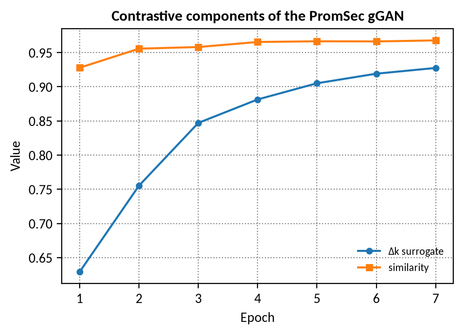

# PromSec

Implementation of *PromSec: Prompt Optimization for Secure Generation of Functional Source Code with Large Language Models (LLMs)*, ACM CCS 2024 ([paper](https://doi.org/10.1145/3658644.3690298)).

PromSec optimizes prompts so that an LLM generates secure and functional Python code. A graph generative adversarial network (gGAN) works on the code graph and identifies the statements to revise. The LLM revises the code, infers an optimized prompt from the revised code, and generates new code from that prompt. Bandit checks the result, and the loop repeats until no CWE is left or the iteration budget is spent.

## How PromSec works

Each iteration on a program `c`:

1. **Scan.** Bandit lists the CWEs in `c`.
2. **Graph update.** `c` becomes a statement graph: one node per statement, with control-structure and def-use edges. The gGAN generator updates the node features, and the statements whose nodes change most (at most 5) are selected.
3. **Code reconstruction.** The LLM revises `c`, guided by the selected statements, and keeps the rest of the program's behavior.
4. **Prompt inference.** The LLM writes a prompt that would generate the revised code securely.
5. **Generation.** The LLM generates new code from that prompt.
6. **Check.** Bandit scans the new code. The loop stops when no CWE is left or after 20 iterations, and keeps the version with the fewest CWEs.

The gGAN is trained with the paper's objective: a contrastive loss that rewards CWE reduction and similarity to the original graph, plus an adversarial loss. Its input is the code graph alone; Bandit labels are used only to build the training data. This implementation differs from the paper in the code graph, the graph-to-code step and the training data; [documentation/METHOD.md](documentation/METHOD.md) gives the details and lists the differences.

To see which statements the gGAN selects in any program:

```bash
cd PromSec
python -m promsec select --file data/test/test_file11.py
```

## Setup

Python 3.10 or newer, Bandit (installed from `requirements.txt`), an OpenAI-compatible chat endpoint, and `tmux` for the unattended scripts in `scripts/` (make sure `tmux` is on your `PATH`).

```bash
cd PromSec
python -m venv .venv
source .venv/bin/activate
pip install -r requirements.txt
python -m promsec selftest-offline     # unit tests, no LLM needed
python -m promsec selftest             # the whole loop with a mock LLM
```

Put the API key on one line in `api_key.txt`, and the endpoint and model name in `llm_config.env` (copy the two `.example` files). Both files are ignored by git. Alternatively, export `OPENAI_API_KEY`, `PROMSEC_LLM_MODEL` and `PROMSEC_LLM_BASE_URL`. The LLM judge uses the same endpoint unless `PROMSEC_JUDGE_MODEL` and `PROMSEC_JUDGE_BASE_URL` are set.

## Run the performance analysis

One command runs PromSec on the 100 evaluation programs, scores functionality preservation with the LLM judge, and writes the report and figures. It runs in `tmux`, continues after you disconnect, and resumes where it stopped.

```bash
cd PromSec
bash scripts/setup_venv.sh                                   # once: virtual environment and tests
PROMSEC_CONFIG=configs/smoke.yaml bash scripts/run.sh        # optional: 3 programs, 1 iteration, checks the endpoint (a few minutes)
bash scripts/run.sh                                          # PromSec on the 100 evaluation programs
bash scripts/status.sh                                       # progress
bash scripts/watch.sh                                        # live log
bash scripts/stop.sh                                         # stop; resume with: bash scripts/run.sh --clear-stop
```

`run.sh` first checks Bandit and asks the LLM a toy question. Each configuration runs in its own tmux session (`promsec_default`, `promsec_smoke`, ...), so `status.sh`, `watch.sh` and `stop.sh` act on the run in `PROMSEC_CONFIG` (default: `configs/default.yaml`); set it for any other run, for example `PROMSEC_CONFIG=configs/smoke.yaml bash scripts/status.sh`. While a run is in progress, `runs/<run name>/logs/results.log` prints one row per finished program (CWEs before and after, graph similarity, LAAJ).

The same steps without tmux:

```bash
cd PromSec
python -m promsec llm-check
python -m promsec run                  # the PromSec loop
python -m promsec judge                # LAAJ and gated LAAJ
python -m promsec report               # table, summary and figures
```

**Outputs** (`runs/promsec/report/`):

- `per_sample.csv`: per program, CWEs before and after, iterations, the four functionality scores, and the AST similarity of the original and final programs (reported for reference);
- `summary.json`: totals and means;
- `cwe_count_per_code_base.png`: CWE count of each program before (red) and after (green) PromSec;
- `functionality_per_code_base.png`: graph similarity, embedding similarity, LAAJ and gated LAAJ of each program;
- `cwe_id_histogram.png`: number of programs with each CWE ID before (red) and after (green) PromSec;
- `performance_eval.png`: the three figures in one.

The final programs are in `runs/promsec/vetted_code/`, and each program's iterations (selected statements, optimized prompts, CWEs) in `runs/promsec/samples/`.

**Ablation.** `configs/no_ggan.yaml` runs the same loop with the same LLM requests but without the gGAN's statement selection. To repeat every run reported below (PromSec, the ablation, and the PromSec-S variant described at the end) and write the comparison table to `runs/comparison.md`:

```bash
cd PromSec
bash scripts/compare_start.sh
bash scripts/compare_status.sh
bash scripts/compare_stop.sh           # resume with: bash scripts/compare_start.sh --clear-stop
```

## Metrics

**Security.** Bandit 1.9.4 reports the CWEs of the original and the final program.

- *CWEs before / left:* distinct CWE IDs per program, summed over the programs.
- *Programs secured:* programs with no CWE left.

**Functionality preservation.** Four scores between 0 and 1 compare the final program with the original:

- *Graph similarity:* cosine similarity of Weisfeiler-Lehman subtree features of the two statement graphs.
- *Embedding similarity:* cosine similarity of the two graphs' mean node features (the similarity term of PromSec's objective).
- *LAAJ (LLM as a judge):* the judge extracts a behavioral contract from the original program (its intent, input-output behavior, side effects, invariants and edge cases) and scores how well the final program satisfies it.
- *Gated LAAJ:* the LAAJ score, set to 0 when the final program does not compile, changes a public function signature or route, or drops an entry point.

Graph and embedding similarity measure structural closeness, which is not an accurate surrogate for functionality. PromSec regenerates the code from an inferred prompt, so a final program can rename, reorder and restructure its statements and keep its behavior (low graph similarity, functionality preserved). A small edit can also break the behavior while the graph barely changes (high similarity, functionality lost). LAAJ therefore scores the behavior directly. The gated variant adds hard checks a judge can miss: the program must still compile and expose the same interface.

## Results

LLM: gpt-oss-120b (temperature 0); Bandit 1.9.4; the 100 evaluation programs hold 216 CWEs; at most 20 iterations. Mean [min–max] over independent runs.

| | Runs | CWEs left | Programs secured | Graph sim. | Embedding sim. | LAAJ | Gated LAAJ |
|---|---|---|---|---|---|---|---|
| **PromSec** | 2 | **21.0** [17–25] | **79.5** [76–83] | 0.39 | 0.85 | 0.53 | 0.45 |
| Without the gGAN | 3 | 51.0 [49–53] | 51.3 [49–55] | 0.38 | 0.86 | 0.49 | 0.41 |

- **Security.** PromSec removes 90% of the CWEs (216 → 21) and secures about 80 of the 100 programs. The same loop without the gGAN leaves 2.4 times as many CWEs and secures about 51 programs. The difference is largest for OS command injection (CWE-78: 7–9 programs left with PromSec, 31–32 without the gGAN) and for binding a server to all interfaces (CWE-605: 0–1 vs 11–13), which the regenerated code otherwise introduces.
- **Functionality.** The scores are similar with and without the gGAN: the gGAN improves security without reducing functionality preservation.

The runs are in `results/` (final programs, per-iteration records, judge scores, `per_sample.csv`, `summary.json` and the figures above). `results/comparison.md` adds the CWEs left per CWE ID and the localization precision and recall of the selected statements. To rebuild every report and figure from the records, without an LLM:

```bash
cd PromSec
python -m promsec archive-report
```

Results from other LLMs will differ.

## Training dynamics of the gGAN

The trained gGAN is in `models/promsec/`: `generator.pt`, `meta.json` (selection settings and the weights' SHA-256, checked at load time), `training.json` (settings, per-epoch losses, held-out results) and `training_curves.png`. To print the per-epoch losses and redraw the curves:

```bash
cd PromSec
python -m promsec training-curves
```



The figure shows the two components of the contrastive score: the CWE-reduction term Δk rises as the generator learns to change the flagged statements, and the similarity term S stays high because the other statements change little. `models/promsec/training_curves.png` adds the generator and discriminator losses and the two terms of the generator loss; [documentation/TRAINING.md](documentation/TRAINING.md) shows it.

On held-out training states, the statements the gGAN selects are flagged by Bandit with precision 0.60 and recall 0.83 (F1 0.70); a random choice of five statements reaches F1 0.05.

To retrain (about 11 minutes on one GPU):

```bash
cd PromSec
python -m promsec train --out models/promsec_retrained
python -m promsec training-curves --model-dir models/promsec_retrained
```

Set `ggan.model_dir` in the config to use the new model. [documentation/TRAINING.md](documentation/TRAINING.md) describes the training data and settings, and how to regenerate the training states with another LLM.

## PromSec-S: a supervised variant

This repository also includes PromSec-S, a variant for further research. **PromSec-S is not part of the CCS 2024 paper**; when comparing against PromSec, use the default configuration.

PromSec-S keeps the PromSec loop, statement graph and training data, and changes how the gGAN is trained. Its generator predicts directly which statements carry a weakness (supervised by Bandit labels on the training states) and which kind of edit fixes each, with a small adversarial term. The LLM then receives the selected statements together with a proposed fix for each, for example "replace the risky call with a safer API, for example `yaml.safe_load`".

| | Runs | CWEs left | Programs secured | Graph sim. | Embedding sim. | LAAJ | Gated LAAJ |
|---|---|---|---|---|---|---|---|
| PromSec-S | 2 | 16.5 [16–17] | 84.0 [83–85] | 0.37 | 0.84 | 0.46 | 0.39 |

Its selection is more precise (held-out precision 0.74, F1 0.75), and it leaves fewer CWEs than PromSec, at lower functionality scores. Run it and view its training dynamics with:

```bash
cd PromSec
PROMSEC_CONFIG=configs/promsec_s.yaml bash scripts/run.sh
python -m promsec training-curves --model-dir models/promsec_s
python -m promsec train-s --out models/promsec_s_retrained   # retrain (about 2.5 hours on one GPU)
```

## Repository

```
promsec/          the PromSec loop, gGANs, training, evaluation and reports
evaluation/       LLM judge (LAAJ)
configs/          default.yaml (PromSec), no_ggan.yaml, promsec_s.yaml, smoke.yaml, compare/
data/             test (100 programs), training (500 programs), states (gGAN training states)
models/           trained gGANs with their training records and curves
results/          the runs reported above, and comparison.md
scripts/          unattended runs in tmux
tests/            unit and end-to-end tests
documentation/    METHOD.md, TRAINING.md, DATA.md
```

`python -m promsec selftest-offline` runs the unit tests: graph construction, the exact LLM requests, the losses, both shipped models (checksums and selections on a fixed program), the training-data pipeline (including kill and resume), the loop with a mock LLM, the reports, and the consistency of the shipped results with their records.

## Citation

```bibtex
@inproceedings{nazzal2024promsec,
  author    = {Nazzal, Mahmoud and Khalil, Issa and Khreishah, Abdallah and Phan, NhatHai},
  title     = {PromSec: Prompt Optimization for Secure Generation of Functional Source Code with Large Language Models (LLMs)},
  booktitle = {Proceedings of the 2024 ACM SIGSAC Conference on Computer and Communications Security (CCS '24)},
  year      = {2024},
  pages     = {2266--2279},
  publisher = {ACM},
  doi       = {10.1145/3658644.3690298}
}
```

## License

MIT. See `LICENSE`.
