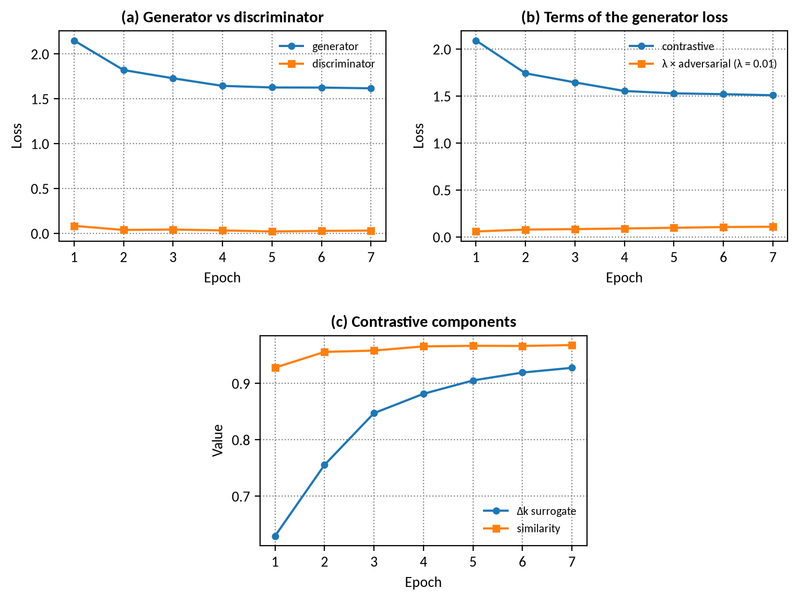
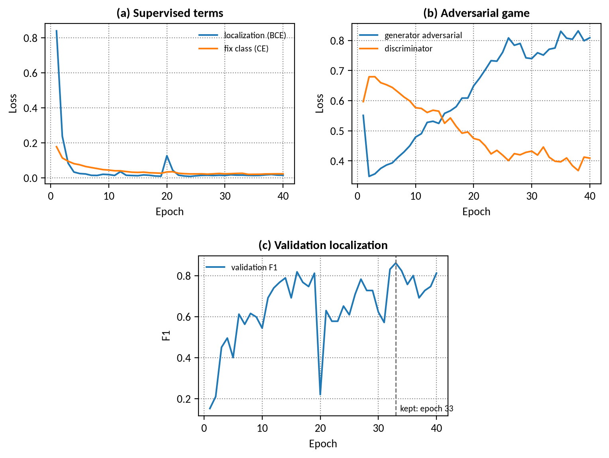

# Training

## Training states

Both gGANs train on the 629 states in `data/states/`. A state is one version of a training program: its code (`<id>.py`), the next version in its fix chain (`<id>.next.py`), and a record (`<id>.json`) with

- `loc`: per statement, 1 if Bandit reports a finding on it;
- `cwe_count`: the number of distinct CWE IDs Bandit reports;
- `fix`: per statement, the edit the accepted fix made (keep, replace the call, change the arguments, other modification, delete, insert a statement before); used by PromSec-S only;
- `group`, `program`, `scenario`, `round`: where the state comes from.

The states come from LLM fix-and-rescan chains on training programs ([DATA.md](DATA.md)). The 100 evaluation programs are never used for training.

```bash
python -m promsec training-data          # chains (LLM; resumable)
python -m promsec training-data-status
python -m promsec states                 # label every version with Bandit -> data/states
```

**Split.** States are grouped by program origin, so that all versions of a program, and all synthesized programs of one application context, fall on the same side. 20% of the groups (6 groups, 124 states) are held out to score localization; the rest train the models.

## PromSec gGAN

```bash
python -m promsec train --out models/promsec_retrained
```

Paper objective ([METHOD.md](METHOD.md)): α = 1, β = 10, λ = 0.01, margin 0.25, 16 negatives, 5 discriminator steps per generator step, 7 epochs, learning rate 0.001, seed 0. Training takes about 11 minutes on one GPU.



Over the 7 epochs, the contrastive loss falls from 2.09 to 1.51, the CWE-reduction surrogate Δk rises from 0.63 to 0.93, and the similarity S stays high (0.93 to 0.97): the generator learns to change the flagged statements while leaving the others nearly unchanged. `python -m promsec training-curves` prints these values per epoch and redraws the figure.

## PromSec-S gGAN (variant, not part of the paper)

```bash
python -m promsec train-s --out models/promsec_s_retrained
```

Supervised localization and fix-class losses plus an adversarial term with weight 0.1, 40 epochs, Adam (learning rate 0.001, weight decay 0.0001). 15% of the training groups are used for validation; the epoch with the best localization F1 on their revised states, the kind of code the loop revises, is kept (epoch 33, F1 0.86). The run also scores generalization to unseen weakness types (below), and takes about 2.5 hours on one GPU.



## Held-out localization

Selected statements against Bandit's flagged statements on the 124 held-out states (191 flagged statements among 6,457). "Original" states are the programs as written; "revised" states are versions an LLM has already revised once or more.

| Model | Precision | Recall | F1 | F1, original | F1, revised |
|---|---|---|---|---|---|
| PromSec gGAN | 0.60 | 0.83 | 0.70 | 0.83 | 0.49 |
| PromSec-S gGAN | 0.74 | 0.76 | 0.75 | 0.85 | 0.57 |
| Five statements at random | 0.03 | 0.10 | 0.05 | | |

PromSec-S also predicts the edit class of the 1,259 held-out statements with fix labels, with macro F1 0.52 over the five edit classes (keep excluded).

**Unseen weakness types (PromSec-S).** For each of the 12 synthesized weakness scenarios, a model is trained without any state of that scenario and scored on its states. F1 ranges from 0.13 to 0.61; a random choice of five statements reaches 0.02 to 0.05 on the same states. The full table is in `models/promsec_s/training.json` (`leave_one_scenario_out`).

## In the loop

`results/comparison.md` reports localization during the evaluation runs, on the code the loop actually revises: precision 0.57 and recall 0.39 for PromSec, 0.71 and 0.33 for PromSec-S.

## Model files

Each model folder holds `generator.pt` (weights), `meta.json` (selection settings and the SHA-256 of `generator.pt`, checked at load time), `training.json` (settings, per-epoch losses, held-out results) and `training_curves.png/.pdf` (the PromSec gGAN also has `contrastive_components.png/.pdf`). PromSec-S also has `hints.json`, the call replacements and argument changes mined from the accepted fixes, used to word the proposed fixes.
